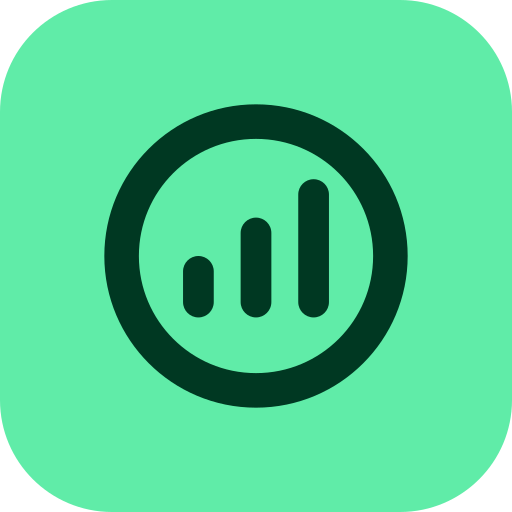
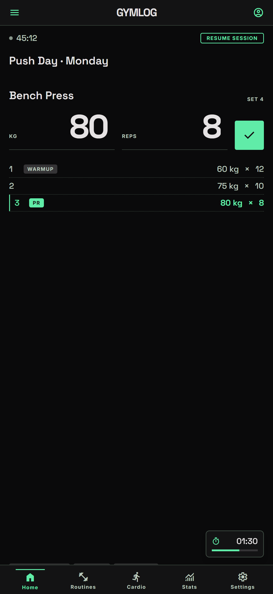
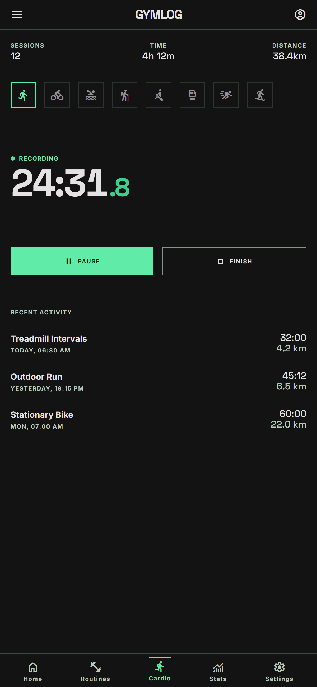
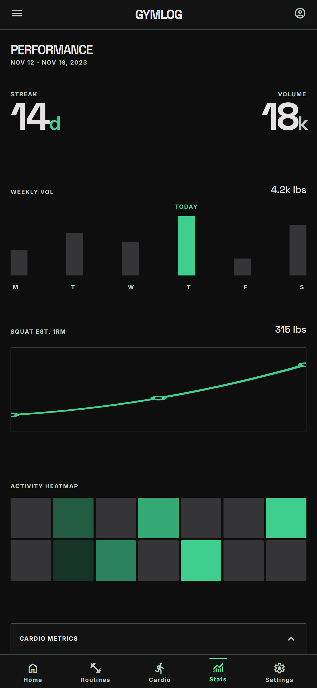
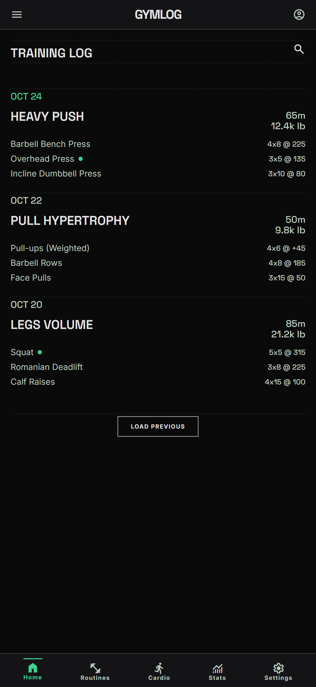

<div align="center">
  

  

  <br>

<a href="https://git.io/typing-svg"></a>

  <p>PWA + app nativa Android/iOS para el registro y análisis de entrenamientos de <b>fuerza</b> y <b>cardio</b>. Diseñada con enfoque <b>offline-first</b>, autenticación con Google, notificaciones inteligentes y experiencia nativa real con Capacitor 8.</p>

  <p>
    <a href="https://app.gymlog.dpdns.org"></a>
    <a href="https://gymlog.dpdns.org/download/gymlog.apk"></a>
  </p>

  <p>
    
    
    
    
    
    
  </p>

  <p>
    
    
    
    
    
    
    
  </p>

  
</div>

---

## Gallery

<div align="center">
  <table>
    <tr>
      <td></td>
      <td></td>
      <td></td>
      <td></td>
    </tr>
    <tr>
      <td align="center"><sub>Workout en vivo</sub></td>
      <td align="center"><sub>Cardio</sub></td>
      <td align="center"><sub>Dashboard</sub></td>
      <td align="center"><sub>Historial</sub></td>
    </tr>
  </table>
</div>

---

<div align="center">
  <table>
    <tr>
      <td></td>
      <td></td>
      <td></td>
      <td></td>
      <td></td>
      <td></td>
      <td></td>
      <td></td>
    </tr>
  </table>
</div>

---

## Core Features

<table>
  <tr>
    <td align="center" width="50%"><b>Registro de Fuerza</b>
      <p>Series con peso × reps, validación Zod, detección automática de PRs con Brzycki, confetti, temporizador de descanso con alarma y referencia de sesión anterior.</p>
    </td>
    <td align="center" width="50%"><b>Módulo Cardio</b>
      <p>Cronómetro en vivo con pausa/reanudar para 8 tipos de actividad, registro de distancia, calorías y notas. Estadísticas semanales.</p>
    </td>
  </tr>
  <tr>
    <td align="center" width="50%"><b>Analíticas Premium</b>
      <p>Dashboard con KPIs, gráficos de volumen semanal, distribución muscular, progresión por ejercicio, análisis de fatiga neuromuscular y calculadora 1RM.</p>
    </td>
    <td align="center" width="50%"><b>Experiencia Nativa</b>
      <p>Edge-to-Edge, haptics, biometría (Face ID / huella), deep links, notificaciones push y locales, compartir entrenamientos, multiidioma ES/EN.</p>
    </td>
  </tr>
  <tr>
    <td align="center" width="50%"><b>Entrenador IA (opt-in)</b>
      <p>Apagado por defecto. Sugiere carga y ajustes, pero <b>nunca modifica nada</b>: propone y tú aplicas. La clave del proveedor vive solo en el servidor.</p>
    </td>
    <td align="center" width="50%"><b>Autorregulación sin IA</b>
      <p>Motor determinista por RIR/RPE que calcula la carga siguiente <b>en el dispositivo</b>, sin red y con el entrenador IA apagado.</p>
    </td>
  </tr>
  <tr>
    <td align="center" width="50%"><b>Rutinas Semanales</b>
      <p>Planes predefinidos (PPL, Full Body...) y rutinas personalizadas. Planificación diaria L-D con sugerencia automática de ejercicios del día.</p>
    </td>
    <td align="center" width="50%"><b>Offline-First</b>
      <p>Outbox en IndexedDB con reintentos + descarte inteligente. Caché de queries persistida. La app funciona sin conexión y sincroniza al recuperar red.</p>
    </td>
  </tr>
  <tr>
    <td align="center" width="50%"><b>Wearables</b>
      <p>Integración con Health Connect / HealthKit vía plugin Capacitor propio HealthBridge. Pasos, FC, sueño, workouts de cualquier dispositivo.</p>
    </td>
    <td align="center" width="50%"><b>Export / Import Excel</b>
      <p>Libro .xlsx de 3 hojas con round-trip sin pérdida. Importa tanto formato exportado como hojas hechas a mano.</p>
    </td>
  </tr>
</table>

---

## Quick Start

<div align="center">
  
</div>

### 1. Dev

```bash
npm install
npm run dev              # http://localhost:5173
```

### 2. Verify

```bash
npm run lint             # ESLint
npm run type-check       # tsc -b --force
npm run test             # 858 tests en 73 ficheros (Vitest)
npx playwright test      # 5 specs E2E (e2e/) — requiere E2E_EMAIL/E2E_PASSWORD para los autenticados
```

El flujo E2E **con sesión iniciada** (`e2e/workout-session.spec.ts`) se salta si no
encuentra credenciales, para que CI siga en verde sin secretos. Para ejecutarlo,
pon en `.env.local` una cuenta **desechable** (el test escribe un entreno real):

```bash
E2E_EMAIL=cuenta-de-pruebas@ejemplo.com
E2E_PASSWORD=...
```

Ya hay una cuenta creada para esto, con ~10 semanas de historial sembrado (30
entrenos, 270 series, rutina activa, cardio y medidas), para que las pantallas de
estadísticas e historial no salgan vacías al auditar la UI. Sus credenciales viven
solo en `.env.local`. Si hay que recrearla o resembrar sus datos:
`scripts/seed-e2e-user.sql` documenta el proceso completo, incluida la limpieza.

### 3. Build

```bash
npm run build            # tsc -b + vite build → dist/
npm run build:android    # + cap sync android
npm run apk              # build:android + APK firmado
```

### 4. Env

```bash
VITE_SUPABASE_URL=<url>
VITE_SUPABASE_KEY=<anon-key>
VITE_SENTRY_DSN=<dsn>                     # opcional
VITE_CLOUDFLARE_ANALYTICS_TOKEN=<token>   # opcional, solo web
```

Crear `.env.local`. Sin Supabase → pantalla negra.

> La clave del proveedor de IA **no es una variable `VITE_*`**: viviría en el cliente y por tanto sería pública. Va en los secretos de la Edge Function (`supabase secrets set`), como se detalla en la sección del entrenador IA.

---

## Project Activity

<div align="center">
  
</div>

---

## Stack Tecnológico

| Capa               | Tecnología                 | Función                                                                        |
| :----------------- | :------------------------- | :----------------------------------------------------------------------------- |
| **Mobile Runtime** | Capacitor 8.3              | Puente nativo: haptics, biometría, notificaciones, deep links, share           |
| **Frontend**       | React 19.3, TypeScript 5.7 | UI reactiva con lazy loading y transiciones animadas                           |
| **Routing**        | React Router 8             | Rutas con `lazy()` y tabla de rutas cubierta por tests                         |
| **Estilos**        | Tailwind CSS 4.2           | CSS-first vía `@tailwindcss/vite`: **no hay `tailwind.config.js`**             |
| **Animaciones**    | Framer Motion 12           | `LazyMotion` + `MotionConfig reducedMotion="user"` (respeta ahorro de energía) |
| **Data Flow**      | TanStack Query 5           | Estado del servidor, caché, invalidación y sincronización con Supabase         |
| **Global Store**   | Zustand 5                  | Estado local persistido: workout activo, rutinas, cardio, ajustes              |
| **Gráficos**       | Recharts 3                 | Volumen semanal, distribución muscular, progresión por ejercicio               |
| **Iconos**         | reicon-react               | Set generalista + `Icon*` propios de dominio, tras un único barril             |
| **Virtualización** | TanStack Virtual 3         | Biblioteca de ejercicios sin montar la lista entera                            |
| **Validación**     | Zod 3                      | Validación de series (reps/peso) con mensajes tipados                          |
| **i18n**           | i18next 26 + react-i18next | Multiidioma ES/EN con detección automática y persistencia                      |
| **Backend**        | Supabase                   | PostgreSQL, Auth (Google OAuth), RLS, RPC, tipos auto-generados                |
| **Edge Functions** | Deno (Supabase)            | `ai-coach` (entrenador IA) y `send-push` (notificaciones remotas)              |
| **PWA**            | vite-plugin-pwa            | Service worker, instalable, offline-first, prompt de actualización in-app      |
| **Persistencia**   | TanStack Persist + idb     | Caché de queries en IndexedDB, con escrituras agrupadas (`PersistGate`)        |
| **Drag & Drop**    | dnd-kit                    | Reordenar ejercicios de rutina por arrastre                                    |
| **Errores**        | Sentry (@sentry/capacitor) | Captura de errores de webview **y** crashes nativos                            |
| **Wearables**      | HealthBridge (nativo)      | Plugin Capacitor propio — Health Connect + HealthKit                           |
| **Excel**          | exceljs                    | Export/import .xlsx de fuerza, cardio y rutinas (carga diferida)               |
| **Testing**        | Vitest 4 + Playwright      | Tests unitarios colocalizados + E2E mobile-first                               |
| **CI/CD**          | GitHub Actions             | 6 workflows: CI, APK, iOS (smoke y firmado), landing, diagnóstico              |
| **Bundler**        | Vite 6                     | Dev server HMR + build optimizado con chunk splitting                          |
| **Seguridad**      | jwt-decode                 | Validación JWT en cliente para flujos seguros (opcional)                       |
| **Notificaciones** | sonner                     | Toasts modernos para UX fluida                                                 |

---

## Sistema de Diseño

Reskin **FitBody** (julio 2026) + material **Liquid Glass** (agosto 2026). Antes era el sistema «Stitch» de acento menta; las capturas y documentos que se vean en verde son de esa etapa.

| Token             | Valor                                                                 |
| :---------------- | :-------------------------------------------------------------------- |
| Acento            | `#ffd93d` (amarillo lima) **por defecto** — el usuario elige entre 24 |
| Base / superficie | `#0a0a0b` / `#26262b`                                                 |
| Tipografía        | **Inter** (cuerpo) + **Space Grotesk** (display y cifras tabulares)   |
| Material          | 3 capas: `glass-1` contenido · `glass-2` elevado · `glass-3` flotante |

### Liquid Glass

Un vidrio no se reconoce porque deje ver lo que hay detrás, sino por **cómo le da la luz**: canto luminoso arriba, caída de luz hacia abajo y un borde que define sin encerrar. Lo de «ver a través» resulta ser la parte cara y la prescindible.

- **La capa se elige por función, nunca por aspecto**, y no se anidan capas del mismo nivel. Una tarjeta dentro de otra idéntica es señal de que la jerarquía está mal, no de que falte una capa.
- **Sin `backdrop-filter`**, y por dos medidas, no por gusto. Con el acento pasando por debajo, ningún velo translúcido alcanza AA a ninguna opacidad — es aritmética de composición alpha, no algo ajustable. Y el blur ya se midió en julio y se quitó por jank en el WebView de Android. La señal de «hay algo pasando por debajo» la da el **difuminado de borde de scroll**, que se pinta una vez en vez de remuestrear el fondo en cada frame.
- **La luz se gasta en el canto, no en el área.** Aclarar 1 px de borde no toca el contraste del texto; aclarar toda la superficie sí, y con los 24 acentos rompe el AA.
- **Lo que tapa contenido no puede ser translúcido**, aunque sea capa 3. El 4 % de `glass-3` está pensado para chrome delgado —una barra de 56 px sobre contenido que se desplaza—, donde solo deja intuir que hay algo debajo. En un panel del 80 % de ancho y alto completo ese mismo 4 % deja **leer** lo de detrás: el cajón de navegación enseñaba el titular de la portada por debajo del menú. Para esos casos está `glass-solid`, que conserva canto, brillo y sombra y solo quita el alpha. Los modales no lo necesitan: con su velo al 60 % detrás, el residuo cae por debajo de lo representable en 8 bits (medido: banda vacía con amplitud 0).
- Medido en una Galaxy Tab A7 (Android 12, gama media-baja de 2020): **1 frame con jank de 384, p99 11 ms**.

**Modo claro completo**: Ajustes → Preferencias → Tema (OSCURO / CLARO). Vive en `settingsStore.theme` + el bloque `:root.light` de `tokens.css`, y es independiente del tema del sistema.

**Acentos configurables**: 24 presets en `@shared/constants/accents.ts`, cada uno con su pareja clara y oscura — en claro el acento tiene que ser oscuro porque también se usa como color de texto sobre blanco. En Android el icono del lanzador sigue al acento elegido.

**Iconos**: todo pasa por `@shared/components/icons`. Ningún componente importa de la librería directamente, que es lo que convierte «cambiar de librería de iconos» en tocar un fichero y no 68.

La fuente única de los tokens es `src/shared/styles/tokens.css`; `src/index.css` los mapea a utilidades Tailwind con `@theme inline`. **Nunca se hardcodean colores hex en componentes** — las excepciones son los ficheros de paleta (`features/stats/constants.ts`, porque Recharts no resuelve `var()` en `fill` SVG de forma fiable, y `@shared/constants/`) y el logotipo de Google, que son colores de marca de un tercero.

Diseño completo y mediciones: `openspec/changes/liquid-glass-design-system/design.md`.

---

## Arquitectura

Organización vertical en **feature slices**. Cada dominio es autocontenido. Lo compartido va por `@shared/`.

```text
src/
├── app/                      # Wiring global
│   ├── components/           #   Layout, PermissionRequests
│   ├── providers.tsx         #   QueryClientProvider + PersistGate + Toaster
│   ├── persistGate.tsx       #   Restore + guardado agrupado de la caché
│   ├── queryClient.ts        #   TanStack Query config
│   ├── queryPersister.ts     #   Persister IndexedDB
│   └── sessionTasks.ts       #   Registro de tareas de cierre de sesión
├── features/                 # Dominios autocontenidos
│   ├── auth/                 # Google OAuth, onboarding, ajustes, biometría
│   ├── cardio/               # Cronómetro, historial, estadísticas
│   ├── coach/                # Entrenador IA opt-in (api/ components/ pages/ stores/ utils/)
│   ├── fitbody/              # Escaparate del reskin
│   ├── guide/                # Guía de uso en la app
│   ├── routine/              # Rutinas semanales
│   ├── stats/                # Dashboard, historial, mediciones, autorregulación
│   ├── wearables/            # Health Connect / HealthKit
│   └── workout/              # Registro de fuerza
├── shared/
│   ├── api/                  #   queries.ts, exerciseMutations
│   ├── components/           #   ErrorBoundary, EmptyStates, SwipeToDelete, fitbody/, icons/, ui/
│   ├── constants/            #   accents, muscleColors, muscleGroups, links
│   ├── hooks/                #   useWeight, useVisibilityPausedInterval, useRateLimit...
│   ├── lib/                  #   brzycki, supabase, i18n, alarm, celebration, throttledStorage...
│   ├── stores/               #   settingsStore, outboxStore, notificationsStore
│   └── styles/tokens.css     #   Design tokens (fuente única)
├── types/                    # database.types.ts (auto-generado — nunca editar a mano)
└── assets/                   # hero.png
```

**18 rutas** (aprox.), todas con `lazy()` en `App.tsx`: `/` · `/routines` · `/stats` · `/history` · `/settings` · `/cardio` · `/user-stats` · `/exercises` · `/wearables` · `/notifications` · `/guide` · `/fitbody` · `/coach` · `/coach/memory` · `/login` · `/auth/callback` · `*`

### Aliases

| Alias       | Ruta             |
| :---------- | :--------------- |
| `@`         | `./src`          |
| `@features` | `./src/features` |
| `@shared`   | `./src/shared`   |
| `@app`      | `./src/app`      |

Definidos en `vite.aliases.ts` y sincronizados en `tsconfig.app.json`.

---

## Modelo de Datos

PostgreSQL (Supabase) con Row Level Security. 29 migraciones hasta la fecha.

**Tablas destacadas:** `profiles`, `exercises`, `workouts`, `workout_sets`, `personal_records`, `user_routines`, `routine_templates`, `cardio_sessions`, `body_measurements`, `wearable_*`, `health_sessions`, `ai_coach_*`, `push_tokens`, `notifications`.

Vistas y RPC: `save_workout_with_sets`, `get_workouts_with_sets`, `get_exercises_with_usage`, `get_volume_by_muscle_group`, `v_weekly_volume_by_muscle`, `v_last_trained_by_muscle`, `v_daily_volume`, `pr_rep_band`, `import_health_sessions`, `upsert_wearable_daily` / `_sleep`, `ai_coach_consume_quota` / `_add_tokens` / `_purge`.

> Los cambios de esquema van en `supabase/migrations/` y deben ser **idempotentes**. `src/types/database.types.ts` se regenera con `npm run gen:types` — nunca se edita a mano.

**Edge Functions:** `ai-coach`, `send-push`.

---

## CI/CD

| Workflow            | Disparo             | Acción                                           |
| :------------------ | :------------------ | :----------------------------------------------- |
| `ci.yml`            | push / PR (main)    | lint + type-check + test (Vitest) + build        |
| `android-build.yml` | push main / tags v* | build web + cap sync + APK **debug** (artefacto) |
| `ios-build.yml`     | manual / push       | smoke test iOS (macOS runner)                    |
| `ios-signed.yml`    | manual / tags       | IPA con firma ad-hoc                             |
| `sync-landing.yml`  | push main           | espeja `public/` en `docs/`                      |
| `react-doctor.yml`  | manual              | diagnóstico React                                |

### Utilidades

```bash
npm run gen:types       # regenerar tipos Supabase
npm run analyze         # bundle visualizer
npm run test:coverage   # tests con cobertura V8
npm run check:secrets   # buscar secretos filtrados en dist/
npm run icons           # generar iconos PWA/Android
npm run commit          # commit convencional (Commitizen)
npm run release         # release + CHANGELOG (standard-version)
npm run doctor          # react-doctor
npm run lint:fix        # auto-fix lint
npm run audit:contrast  # auditar contraste
```

---

## Experiencia Nativa (Capacitor 8)

- **Haptic Feedback**: vibraciones al completar series, guardar y batir PRs
- **Acceso Biométrico**: Face ID (iOS) / huella (Android) — plugin propio
- **True Full-Screen**: edge-to-edge con WindowInsets
- **Notificaciones**: locales + push remotas (FCM vía Edge Function `send-push`)
- **Deep Links**: `com.franvi.gymlog://workout/new`, `com.franvi.gymlog://history`, `com.franvi.gymlog://auth/callback`
- **Widget Android**: racha + último entreno
- **Compartir**: resumen vía Web Share API
- **Iconos Adaptativos**: Android 14+, splash screen
- **Pantalla encendida**: mantiene pantalla activa durante entrenamiento (Android)
- **Importadores**: Strong, Hevy, FitNotes

---

## Changelog

El registro completo y automático está en **[CHANGELOG.md](./CHANGELOG.md)**. Última versión publicada: **v5.14.0** (2026-09-30).

---

<div align="center">
  
</div>

## Autoría

<div align="center">

  

  <br>

  

<br><br>

<a href="https://github.com/Haplee"></a>
<a href="https://x.com/FranVidalMateo"></a>
<a href="https://www.instagram.com/franvidalmateo"></a>

<br><br>
<b>GymLog v5.14.0</b> — <a href="https://github.com/Haplee">Francisco Vidal Mateo</a>

</div>
