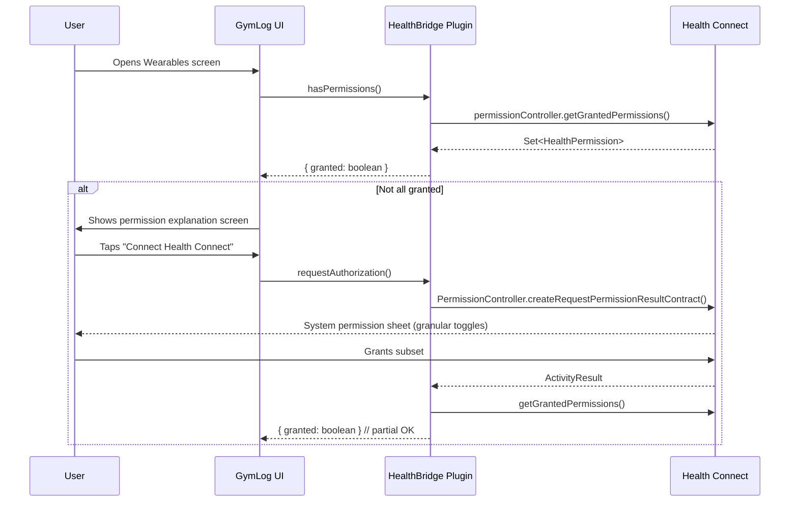
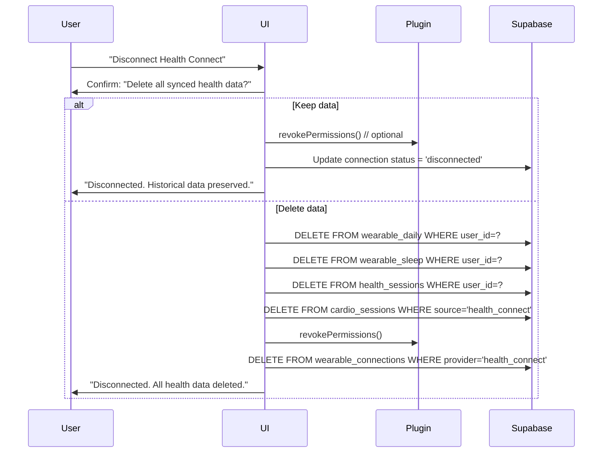

# Permissions & Privacy Design

## Overview

This document defines the permissions strategy, privacy model, and account isolation for Health Connect integration in GymLog.

## Permission Model

### Initial Permissions (MVP 1 - Read Only)

| Permission                                              | Record Types                    | Justification                       |
| ------------------------------------------------------- | ------------------------------- | ----------------------------------- |
| `android.permission.health.READ_HEART_RATE`             | HeartRateRecord                 | Core readiness metric               |
| `android.permission.health.READ_RESTING_HEART_RATE`     | RestingHeartRateRecord          | Baseline for readiness              |
| `android.permission.health.READ_HEART_RATE_VARIABILITY` | HeartRateVariabilityRmssdRecord | HRV for recovery scoring            |
| `android.permission.health.READ_SLEEP`                  | SleepSessionRecord              | Sleep duration, stages, consistency |
| `android.permission.health.READ_STEPS`                  | StepsRecord                     | Daily activity baseline             |
| `android.permission.health.READ_EXERCISE`               | ExerciseSessionRecord           | Workout import (cardio + strength)  |

### Deferred Permissions (Future MVPs)

| Permission                                                 | Record Types               | Trigger                            |
| ---------------------------------------------------------- | -------------------------- | ---------------------------------- |
| `android.permission.health.READ_DISTANCE`                  | DistanceRecord             | When distance-based metrics needed |
| `android.permission.health.READ_TOTAL_CALORIES_BURNED`     | TotalCaloriesBurnedRecord  | When TDEE estimation needed        |
| `android.permission.health.READ_ACTIVE_CALORIES_BURNED`    | ActiveCaloriesBurnedRecord | When active energy needed          |
| `android.permission.health.READ_WEIGHT`                    | WeightRecord               | When weight tracking added         |
| `android.permission.health.READ_VO2_MAX`                   | Vo2MaxRecord               | When fitness level scoring added   |
| `android.permission.health.READ_RESPIRATORY_RATE`          | RespiratoryRateRecord      | When sleep quality enhanced        |
| `android.permission.health.READ_SKIN_TEMPERATURE`          | SkinTemperatureRecord      | When thermal recovery added        |
| `android.permission.health.READ_HEALTH_DATA_IN_BACKGROUND` | All (background)           | When background sync justified     |
| `android.permission.health.READ_HEALTH_DATA_HISTORY`       | Historical (>30 days)      | When deep history needed           |

### Write Permissions (MVP 4+)

- `android.permission.health.WRITE_EXERCISE` - For writing GymLog workouts to Health Connect
- `android.permission.health.WRITE_HEART_RATE` - For manual HR entries
- `android.permission.health.WRITE_SLEEP` - For manual sleep entries
- `android.permission.health.WRITE_STEPS` - For manual step entries

**Rule**: No write permissions in MVP 1-3. Only add when feature requires it.

## Permission Request Flow

### Granular Permission Request



### Partial Acceptance Handling

- User may grant only subset (e.g., steps + sleep, deny HR)
- `hasPermissions()` checks **only requested permissions**
- Sync proceeds with **available permissions only**
- UI shows which metrics are available vs missing
- "Missing permissions" banner with "Grant more" action

### Revocation Handling

```kotlin
// In HealthConnectManager
fun onPermissionsChanged() {
    // 1. Detect revocation via Changes API or periodic check
    // 2. Invalidate cached tokens for revoked types
    // 3. Stop sync for revoked types
    // 4. Notify UI: "Health Connect access reduced"
    // 5. Preserve already-synced data (user choice to delete)
}
```

## Privacy Policy Requirements

### Data Controller Statement

- **GymLog** is data controller for data stored in Supabase
- **Health Connect** stores data on device (user-controlled)
- **Google** is processor for Health Connect platform
- **Wearable vendors** (Samsung, Garmin, etc.) are separate controllers for their clouds

### Data Minimization

1. **Read-only** in MVP 1-3
2. **Only requested record types** - no blanket `READ_HEALTH_DATA`
3. **Local-first processing** - scoring computed on device/app, not uploaded raw
4. **Aggregated sync** - daily summaries, not raw samples
5. **No background reads** without explicit permission

### User Rights Implementation

| Right             | Implementation                                                              |
| ----------------- | --------------------------------------------------------------------------- |
| **Access**        | Wearables screen shows all synced data                                      |
| **Rectification** | Re-sync overwrites; manual edit not supported (source of truth is wearable) |
| **Erasure**       | "Disconnect Health Connect" → deletes all `wearable_*` rows for user        |
| **Portability**   | Export workouts/sleep/health data via existing export feature               |
| **Restriction**   | Granular permissions = restriction by record type                           |
| **Objection**     | Disconnect = complete stop                                                  |

### Disconnection Flow



## Account Isolation (Multi-User Devices)

### Threat Model

- Android device shared by multiple people
- Each has own GymLog account (Supabase auth)
- Health Connect stores **device-level** data, not per-app-user

### Isolation Strategy

```kotlin
// HealthConnectManager.kt
class HealthConnectManager(private val context: Context) {

    // Keyed by GymLog user_id, NOT device
    private val userClients = mutableMapOf<String, HealthConnectClient>()
    private val userPermissions = mutableMapOf<String, Set<HealthPermission>>()
    private val userTokens = mutableMapOf<String, Map<RecordType, String>>() // Changes tokens

    fun getClient(userId: String): HealthConnectClient? {
        // 1. Verify user is currently authenticated in GymLog
        // 2. Return or create client for THIS user
        // 3. NEVER share client across user_ids
    }

    fun onUserSwitch(oldUserId: String, newUserId: String) {
        // 1. Clear old user's cached tokens
        userTokens.remove(oldUserId)
        // 2. New user starts fresh - no auto-association
        // 3. Must explicitly grant permissions for new user
    }
}
```

### Rules

| Scenario                                    | Behavior                                                              |
| ------------------------------------------- | --------------------------------------------------------------------- |
| User A syncs, then User B logs in           | User B sees **empty** Health Connect state; must grant permissions    |
| User A revokes HC permission                | Only User A's sync stops; User B unaffected                           |
| User A deletes account                      | User A's `wearable_*` data deleted via RLS cascade; HC data untouched |
| Same Google account, different GymLog users | **Not supported** - HC tied to Google account; warn user              |
| Work profile / Private space                | Separate HC instances; each GymLog user sees their profile's HC       |

### Implementation Requirements

1. **Auth state listener** in MainActivity → notify native layer on user change
2. **Per-user Changes tokens** stored in Supabase (`wearable_connections.metadata_json`)
3. **No cross-user caching** - each user gets fresh HealthConnectClient
4. **RLS enforcement** - all tables have `user_id` FK with cascade delete

## AndroidManifest Declaration

### Current (Verified)

```xml
<!-- Health Connect (lectura): Amazfit/Zepp, Samsung, Garmin, etc. -->
<uses-permission android:name="android.permission.health.READ_STEPS" />
<uses-permission android:name="android.permission.health.READ_DISTANCE" />
<uses-permission android:name="android.permission.health.READ_TOTAL_CALORIES_BURNED" />
<uses-permission android:name="android.permission.health.READ_ACTIVE_CALORIES_BURNED" />
<uses-permission android:name="android.permission.health.READ_HEART_RATE" />
<uses-permission android:name="android.permission.health.READ_RESTING_HEART_RATE" />
<uses-permission android:name="android.permission.health.READ_SLEEP" />
<uses-permission android:name="android.permission.health.READ_EXERCISE" />
<!-- Background read for sync when app not foreground -->
<uses-permission android:name="android.permission.health.READ_HEALTH_DATA_IN_BACKGROUND" />

<!-- Health Connect rationale activity (Android 13-) -->
<intent-filter>
    <action android:name="androidx.health.connect.action.SHOW_PERMISSIONS_RATIONALE" />
</intent-filter>

<!-- View permission usage (Android 14+) -->
<activity-alias
    android:name="ViewPermissionUsageActivity"
    android:exported="true"
    android:targetActivity=".MainActivity"
    android:permission="android.permission.START_VIEW_PERMISSION_USAGE">
    <intent-filter>
        <action android:name="android.intent.action.VIEW_PERMISSION_USAGE" />
        <category android:name="android.intent.category.HEALTH_PERMISSIONS" />
    </intent-filter>
</activity-alias>

<!-- Package visibility -->
<queries>
    <package android:name="com.google.android.apps.healthdata" />
    <intent>
        <action android:name="androidx.health.connect.action.SHOW_PERMISSIONS_RATIONALE" />
    </intent>
</queries>
```

### To Add (Future Permissions)

```xml
<!-- Add when feature requires -->
<uses-permission android:name="android.permission.health.READ_HEART_RATE_VARIABILITY" />
<uses-permission android:name="android.permission.health.READ_WEIGHT" />
<uses-permission android:name="android.permission.health.READ_VO2_MAX" />
<uses-permission android:name="android.permission.health.READ_RESPIRATORY_RATE" />
<uses-permission android:name="android.permission.health.READ_SKIN_TEMPERATURE" />
<uses-permission android:name="android.permission.health.READ_HEALTH_DATA_HISTORY" />
```

## Play Console Health Apps Declaration

### Pre-Publication Checklist

- [ ] **Data Safety Section**: Declare health data access (read)
- [ ] **Target Audience**: Not children
- [ ] **Health Data Types**: Select all requested types
- [ ] **Purpose**: "Fitness tracking and recovery analytics"
- [ ] **Data Handling**: "Data stored in user's Supabase account, encrypted at rest"
- [ ] **Deletion**: "User can delete all health data from app settings"
- [ ] **Sharing**: "No sharing with third parties"
- [ ] **Encryption**: TLS 1.2+ in transit, Supabase encryption at rest

### Required Assets

- Privacy Policy URL (hosted, accessible)
- Data deletion instructions URL
- Demo video showing health data flow (for review)

## Logging & Audit Trail

### Prohibited in Logs

- ❌ Raw health values (HR, HRV, sleep stages)
- ❌ External record IDs (can correlate)
- ❌ Timestamps with health data
- ❌ User identifiers with health data

### Allowed (Structured, No PHI)

```kotlin
Log.w(TAG, "readAll [2026-01-15..2026-01-20]: daily=7 sleep=6 workouts=2 strength=1 errors=0")
Log.w(TAG, "session type=3 title=Pesas origin=com.zepp.app 2026-01-15T10:00..2026-01-15T11:00")
Log.e(TAG, "readAll/sleep: PERMISSION_DENIED")
```

### Audit Events (Supabase)

```sql
CREATE TABLE health_connect_audit (
  id uuid PRIMARY KEY DEFAULT gen_random_uuid(),
  user_id uuid REFERENCES auth.users(id) ON DELETE CASCADE,
  event_type text NOT NULL, -- 'permission_granted', 'permission_revoked', 'sync_start', 'sync_complete', 'sync_failed', 'disconnect'
  record_types text[],      -- which types affected
  record_count integer,
  error_code text,
  created_at timestamptz DEFAULT now()
);
```

## Summary: MVP 1 Permissions Checklist

| Item                          | Status                                    |
| ----------------------------- | ----------------------------------------- |
| Manifest permissions declared | ✅ (6 read perms + background)            |
| Permission rationale activity | ✅ (Android 13-)                          |
| ViewPermissionUsageActivity   | ✅ (Android 14+)                          |
| Package visibility queries    | ✅                                        |
| Granular request flow         | ✅ (existing in HealthBridgePlugin)       |
| Partial acceptance handling   | ✅ (hasPermissions checks requested only) |
| Revocation detection          | ⚠️ Needs Changes API integration          |
| Multi-user isolation          | ⚠️ Needs per-user client management       |
| Disconnect with delete option | ⚠️ UI + RPC needed                        |
| Play Console declaration      | ⏳ Pre-launch                             |
| Privacy policy update         | ⏳ Pre-launch                             |
