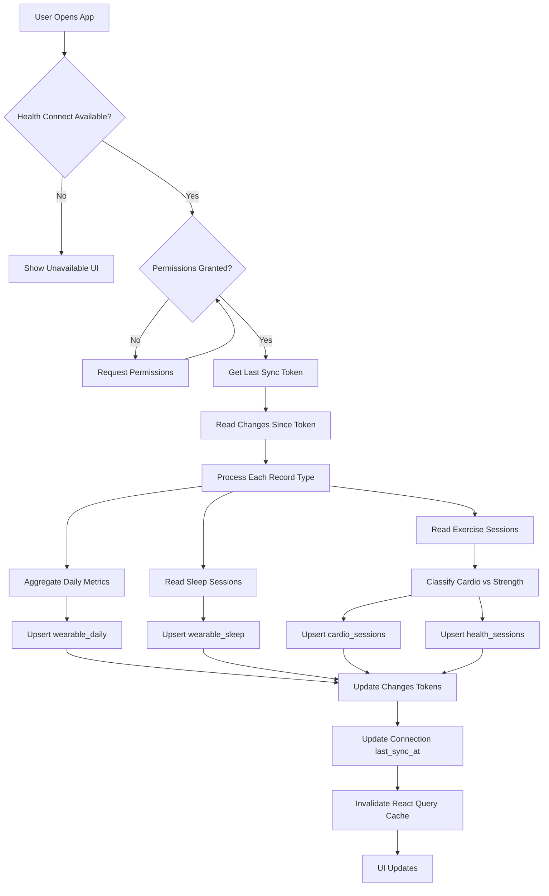
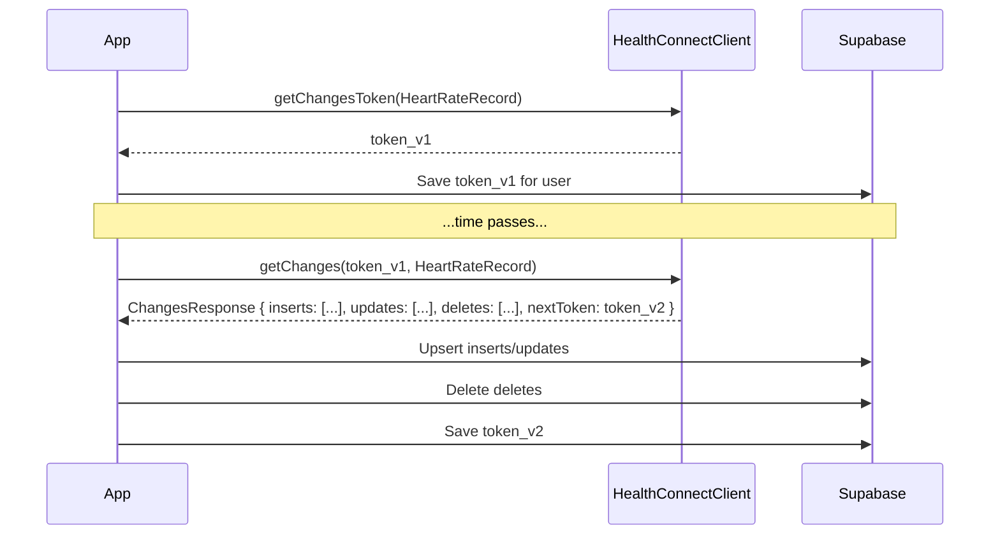
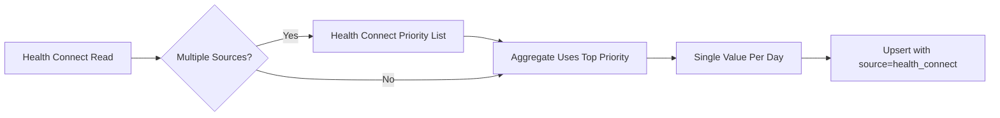

# Sync Architecture Design

## Overview

This document defines the synchronization architecture between Health Connect and GymLog's Supabase backend, covering initial import, incremental sync, deduplication, and error recovery.

## Sync Architecture Diagram



## Phase 1: Initial Import (First Sync)

### Trigger

- User grants permissions for first time
- `wearable_connections.last_sync_at` is null

### Strategy

- **Window**: Last 30 days (configurable, `SYNC_MAX_DAYS`)
- **Method**: Full range read per record type
- **Order**: Daily aggregates → Sleep → Exercise
- **Token Capture**: Save Changes token after each type

### Implementation

```typescript
// healthAggregator.ts - current logic
const windowDays = windowDaysFrom(conn?.last_sync_at, days); // returns 30 if null

const { daily, sleep, workouts, strengthSessions } = await HealthBridge.readAll({
  startDate: ymd(start), // 30 days ago
  endDate: ymd(end), // today
});
```

### Kotlin Plugin Changes Needed

```kotlin
// HealthConnectChangesManager.kt
suspend fun getInitialChangesTokens(recordTypes: Set<RecordType>): Map<RecordType, String> {
    val tokens = mutableMapOf<RecordType, String>()
    for (type in recordTypes) {
        val token = client.changesClient.getChangesToken(
            ChangesTokenRequest(type)
        )
        tokens[type] = token
    }
    return tokens
}
```

## Phase 2: Paginated Reading

### Current Implementation (HealthBridgePlugin.kt)

```kotlin
private suspend fun <T : Record> readAllPages(
    client: HealthConnectClient,
    type: KClass<T>,
    filter: TimeRangeFilter,
): List<T> {
    val all = mutableListOf<T>()
    var token: String? = null
    do {
        val resp = client.readRecords(
            ReadRecordsRequest(type, filter, pageToken = token),
        )
        all += resp.records
        token = resp.pageToken
    } while (token != null && all.size < MAX_RECORDS)
    return all
}
```

### Recommended Page Sizes

| Record Type           | Page Size | Max Records | Rationale                  |
| --------------------- | --------- | ----------- | -------------------------- |
| SleepSessionRecord    | 100       | 1000        | ~3 years of daily sleep    |
| ExerciseSessionRecord | 100       | 1000        | ~3 years of daily workouts |
| HeartRateRecord (raw) | **NEVER** | **NEVER**   | Use aggregates only        |
| StepsRecord (raw)     | **NEVER** | **NEVER**   | Use aggregates only        |

### Aggregate Reading (Preferred)

```kotlin
// Daily aggregates - single call, no pagination
client.aggregateGroupByPeriod(
    AggregateGroupByPeriodRequest(
        metrics = setOf(
            StepsRecord.COUNT_TOTAL,
            DistanceRecord.DISTANCE_TOTAL,
            TotalCaloriesBurnedRecord.ENERGY_TOTAL,
            HeartRateRecord.BPM_AVG,
            HeartRateRecord.BPM_MAX,
            RestingHeartRateRecord.BPM_AVG,
            HeartRateVariabilityRmssdRecord.RMSSD_AVG,  // NEW
        ),
        timeRangeFilter = localFilter,
        timeRangeSlicer = Period.ofDays(1),
    )
)
```

## Phase 3: Persistence of Identifiers

### External ID Format

```
Health Connect:  hc:${record.metadata.id}
HealthKit:       hk:${HKObject.uuid}
Fitbit:          fb:${fitbitLogId}
```

### Changes Token Storage

```sql
-- Add to wearable_connections or new table
ALTER TABLE wearable_connections ADD COLUMN IF NOT EXISTS health_connect_tokens jsonb DEFAULT '{}';
-- Structure: {"HeartRateRecord": "token123", "SleepSessionRecord": "token456", ...}
```

### Kotlin Repository

```kotlin
// HealthConnectRepository.kt
interface HealthConnectRepository {
    suspend fun saveChangesToken(userId: String, recordType: String, token: String)
    suspend fun getChangesToken(userId: String, recordType: String): String?
    suspend fun clearChangesTokens(userId: String)
}
```

## Phase 4: Incremental Sync (Changes API)

### Changes API Flow



### Per-Type Token Strategy

```kotlin
// HealthConnectChangesManager.kt
data class SyncTokens(
    val heartRate: String?,
    val restingHeartRate: String?,
    val hrv: String?,
    val sleep: String?,
    val exercise: String?,
    val steps: String?,        // if reading raw
    val distance: String?,
    val calories: String?,
)

suspend fun syncIncremental(userId: String, tokens: SyncTokens): SyncTokens {
    val newTokens = tokens.copy()

    // Daily aggregates (steps, distance, calories, HR, RHR, HRV) - use aggregate, not changes
    val dailyToken = syncDailyAggregates(userId, tokens.heartRate)
    newTokens = newTokens.copy(heartRate = dailyToken)

    // Sleep - use changes
    val sleepToken = syncSleepChanges(userId, tokens.sleep)
    newTokens = newTokens.copy(sleep = sleepToken)

    // Exercise - use changes
    val exerciseToken = syncExerciseChanges(userId, tokens.exercise)
    newTokens = newTokens.copy(exercise = exerciseToken)

    return newTokens
}
```

### Why Not Changes for Aggregates?

- Daily aggregates are **computed** by Health Connect
- Changes API returns **raw record changes**
- Re-aggregating from raw changes = complex, error-prone
- **Better**: Re-read aggregate for recent window (7 days) + overlap

## Phase 5-7: Change Detection

### Insert Detection

- New record appears in Changes response `inserts`
- New daily aggregate bucket has data where none existed
- **Action**: Insert new row in Supabase

### Modification Detection

- Record appears in Changes response `updates`
- Aggregate value differs from stored value
- Sleep stage minutes changed
- Exercise session duration/calories updated
- **Action**: Upsert (COALESCE preserves non-null)

### Deletion Detection

- Record appears in Changes response `deletes`
- Daily aggregate bucket becomes empty
- **Action**:
  - For `wearable_daily`/`wearable_sleep`: **Do not delete** (preserve history)
  - For `cardio_sessions`/`health_sessions`: **Soft delete** or mark `deleted_at`
  - **Rationale**: User may want history even if source deleted

## Phase 8: Interruption Recovery

### Failure Points & Recovery

| Failure Point               | Recovery Strategy                                               |
| --------------------------- | --------------------------------------------------------------- |
| Network error mid-sync      | Retry with exponential backoff (max 3); preserve partial tokens |
| App killed during sync      | On next start: resume from last saved tokens                    |
| Health Connect unavailable  | Queue sync; retry when `isAvailable()` returns true             |
| Permission revoked mid-sync | Catch SecurityException; stop; mark connection error            |
| Supabase RPC error          | Log error; don't update tokens; retry next sync                 |

### Idempotency Guarantees

```sql
-- All upserts use ON CONFLICT with COALESCE
-- Safe to re-run same data multiple times
INSERT ... ON CONFLICT (user_id, date, source) DO UPDATE SET
  steps = COALESCE(EXCLUDED.steps, wearable_daily.steps),
  -- null in new data preserves old value
```

### Token Update Atomicity

```kotlin
// Only update token AFTER successful Supabase write
suspend fun syncWithTokenPersistence(...) {
    val newToken = try {
        syncAndGetNewToken()
    } catch (e: Exception) {
        // Don't update token - will retry same range
        throw e
    }
    // Success - persist new token
    repository.saveChangesToken(userId, recordType, newToken)
}
```

## Phase 9: Deduplication

### Multi-Provider Deduplication



### Health Connect's Built-in Deduplication

- `aggregateGroupByPeriod` applies **priority list** (user-configurable in HC settings)
- Returns **single value per bucket** - no manual dedupe needed
- Priority order typically: Manual > Pixel Watch > Galaxy Watch > Phone sensors > Third-party

### External ID Uniqueness

```sql
-- cardio_sessions: UNIQUE (user_id, external_id) WHERE external_id IS NOT NULL
-- health_sessions: UNIQUE (user_id, external_id)
-- wearable_daily: UNIQUE (user_id, date, source)
-- wearable_sleep: UNIQUE (user_id, date, source)
```

### Cross-Source Conflict Resolution

| Scenario                                   | Resolution                                               |
| ------------------------------------------ | -------------------------------------------------------- |
| Health Connect + HealthKit (dual platform) | Separate rows per `source`; UI merges for display        |
| Zepp + Samsung Health both writing to HC   | HC priority list wins; single aggregate row              |
| Manual entry + HC import                   | Manual `source='manual'` preserved; HC doesn't overwrite |

## Phase 10: Permission Changes

### Grant New Permission

1. User grants new permission in HC settings
2. Next sync: `hasPermissions()` detects new grant
3. **Full backfill** for new record type (30 days or `SYNC_MAX_DAYS`)
4. Save initial Changes token for new type
5. Subsequent syncs: incremental

### Revoke Permission

1. `hasPermissions()` returns false for type
2. **Stop reading** that type immediately
3. **Preserve** already-synced data (user choice)
4. Clear Changes token for revoked type
5. UI shows "Permission revoked - [metric] not updating"

### Implementation

```kotlin
// HealthConnectPermissionManager.kt
suspend fun handlePermissionChange(
    userId: String,
    oldPermissions: Set<HealthPermission>,
    newPermissions: Set<HealthPermission>
) {
    val granted = newPermissions - oldPermissions
    val revoked = oldPermissions - newPermissions

    granted.forEach { perm ->
        // Trigger backfill for this record type
        syncManager.scheduleBackfill(userId, perm.recordType)
    }

    revoked.forEach { perm ->
        // Clear token, stop sync
        repository.clearChangesToken(userId, perm.recordType)
        connectionManager.updateStatus(userId, "permission_revoked", perm)
    }
}
```

## Phase 11: Account Changes

### User Switch (Same Device)

```kotlin
// MainActivity.kt - on user change
override fun onAuthStateChanged(newUser: User?) {
    val oldUserId = currentUserId
    currentUserId = newUser?.id

    if (oldUserId != null && oldUserId != currentUserId) {
        // 1. Clear HC client for old user
        healthConnectManager.clearUser(oldUserId)

        // 2. New user starts fresh
        //    - No auto-association with old data
        //    - Must grant permissions explicitly
    }
}
```

### Supabase Auth Integration

```typescript
// useWearableSync.ts - on auth change
useEffect(() => {
  if (userId !== previousUserId) {
    ranOnOpenThisSession = false; // Reset sync trigger
    queryClient.clear(); // Clear all cached data
    // Native layer notified via plugin method
    HealthBridge.onUserChange({ previousUserId, newUserId: userId });
  }
}, [userId]);
```

## Sync Scheduling

### Current Triggers (useWearableSync.ts)

1. **App open** (once per session, if `wearablesSyncOnOpen` enabled)
2. **Foreground resume** (throttled: 15 min minimum)
3. **Manual** (pull-to-refresh, settings button)

### Recommended Additions

| Trigger                    | Implementation                                                  |
| -------------------------- | --------------------------------------------------------------- |
| **WorkManager** (periodic) | Daily 4 AM sync for morning readiness                           |
| **Health Connect Changes** | Real-time via `ChangesClient.addChangesListener` (if supported) |
| **Widget update**          | Sync before widget refresh                                      |
| **Post-workout**           | Auto-sync after GymLog workout saved                            |

### WorkManager Config

```kotlin
// HealthConnectSyncWorker.kt
class HealthConnectSyncWorker(
    context: Context,
    params: WorkerParameters
) : CoroutineWorker(context, params) {

    override suspend fun doWork(): Result {
        val userId = getCurrentUserId() ?: return Result.success()
        val granted = hasPermissions(userId) ?: return Result.success()
        if (!granted) return Result.success()

        return try {
            syncAggregator(userId, 7) // Recent week
            Result.success()
        } catch (e: Exception) {
            Result.retry()
        }
    }
}

// Schedule: daily, 4 AM, requires network, battery not low
val request = PeriodicWorkRequestBuilder<HealthConnectSyncWorker>(24, TimeUnit.HOURS)
    .setInitialDelay(4, TimeUnit.HOURS) // 4 AM
    .setConstraints(Constraints.Builder()
        .setRequiredNetworkType(NetworkType.CONNECTED)
        .setRequiresBatteryNotLow(true)
        .build())
    .build()
WorkManager.getInstance(context).enqueueUniquePeriodicWork(
    "health_connect_sync",
    ExistingPeriodicWorkPolicy.KEEP,
    request
)
```

## Error Handling & Monitoring

### Error Classification

```kotlin
sealed class SyncError(val code: String, val recoverable: Boolean) {
    object NotAvailable : SyncError("NOT_AVAILABLE", true)
    object ProviderUpdateRequired : SyncError("PROVIDER_UPDATE_REQUIRED", true)
    object PermissionDenied : SyncError("PERMISSION_DENIED", false)
    object FeatureUnavailable : SyncError("FEATURE_UNAVAILABLE", false)
    object InvalidTimeRange : SyncError("INVALID_TIME_RANGE", true)
    object SyncInterrupted : SyncError("SYNC_INTERRUPTED", true)
    data class ReadFailed(val cause: String) : SyncError("READ_FAILED", true)
    data class UnknownError(val cause: String) : SyncError("UNKNOWN_ERROR", true)
}
```

### Metrics to Track

| Metric                          | Target       |
| ------------------------------- | ------------ |
| Sync success rate               | > 99%        |
| Initial sync duration           | < 30 seconds |
| Incremental sync duration       | < 5 seconds  |
| Token persistence success       | 100%         |
| Permission revocation detection | < 5 min      |

### Health Connect Toolbox Testing

```bash
# Insert test records
adb shell am start -n com.google.android.apps.healthdata/.toolbox.ToolboxActivity

# Or via CLI
adb shell cmd health_connect insert-record --type steps --count 5000 --time 2026-01-15T10:00:00
adb shell cmd health_connect insert-record --type heart_rate --bpm 72 --time 2026-01-15T10:00:00
adb shell cmd health_connect insert-record --type sleep --start 2026-01-14T23:00:00 --end 2026-01-15T07:00:00 --deep 120 --light 240 --rem 90 --awake 30
```

## Summary: Sync Flow per MVP

### MVP 1 (Current + Fixes)

- ✅ Full range read (30 days)
- ✅ Paginated sleep/exercise reads
- ✅ Aggregate daily metrics
- ✅ Upsert with COALESCE
- ⚠️ Add Changes token persistence
- ⚠️ Add per-type token storage
- ⚠️ Add interruption recovery

### MVP 2

- ✅ Incremental sync via Changes API (sleep, exercise)
- ✅ Daily aggregate re-read (7 days + overlap)
- ✅ Deletion handling
- ✅ Deduplication verification
- ✅ Permission change handling

### MVP 3

- ✅ WorkManager periodic sync
- ✅ Background read (if permission granted)
- ✅ Real-time Changes listener
- ✅ Multi-user isolation

### MVP 4

- ✅ Write GymLog workouts to Health Connect
- ✅ Sync conflict resolution (local vs cloud)
